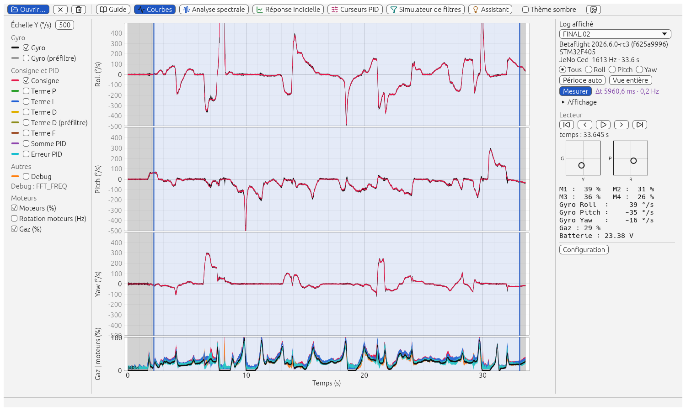
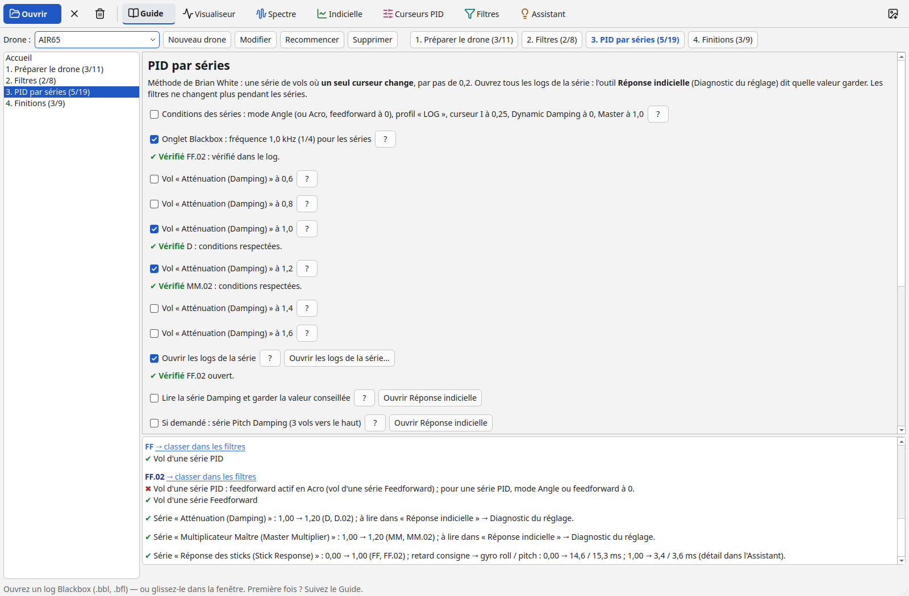
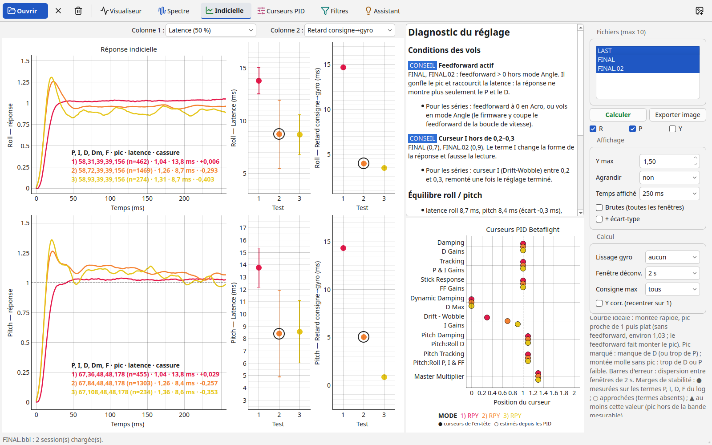
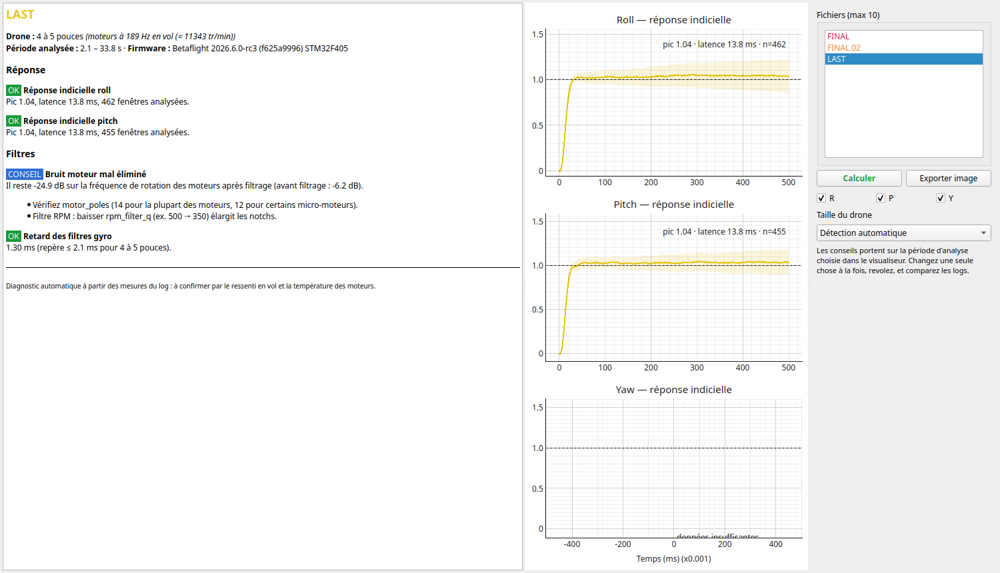

# OpenTuneBox

Boîte à outils d'analyse des logs **Blackbox Betaflight** pour régler les drones de toutes tailles,
du whoop au 10 pouces. Elle reprend les outils de PIDtoolbox Pro V0.94 avec un décodeur et des
calculs entièrement réécrits, et fonctionne **hors ligne** sous Linux et Windows.



## Outils

Au premier lancement, la page **Guide** propose un parcours de réglage à cocher, par drone : préparer le
drone, régler les filtres, puis les PID par séries, puis les finitions. Les valeurs
s'adaptent à la fiche du drone ; les logs ouverts cochent ce qu'ils prouvent et disent quoi corriger avant
le prochain vol, curseur par curseur. Les logs des filtres et ceux des séries PID sont demandés et jugés à
part (fréquence d'enregistrement, protocole), et chaque série d'un drone est reconnue.



La fenêtre principale est le **visualiseur de log** : gyro, consigne, termes P/I/D/F, moteurs, gaz, debug ;
période d'analyse (crash exclu automatiquement), mesure de temps et de fréquence entre deux points, lecteur,
manches, modes de vol. Chaque outil s'affiche par son bouton dans la barre d'outils, dans la même fenêtre (Fréq. × gaz et Fréq. × temps depuis
l'outil Spectre, Configuration depuis le panneau de droite du visualiseur).

| Bouton | Ce qu'il montre |
|---|---|
| Guide | Parcours de réglage à cocher par drone (préparer, filtres, séries PID, finitions), adapté à la fiche du drone ; logs des filtres et des séries PID vérifiés à part (protocole, usages, séries, corrections dans le configurateur) |
| Courbes | Toutes les courbes du vol, lecteur temporel, mesures au curseur |
| Analyse spectrale | Spectres avant/après filtres, retards des filtres, bruit moteur par harmonique ; diagnostic du bruit gyro et D avec stratégie de filtrage (case à cocher) |
| Fréquence × gaz | Cartes de bruit en fonction des gaz (4 colonnes, préréglages type PIDtoolbox) |
| Fréquence × temps | Spectrogrammes avec harmoniques moteur et notchs dynamiques |
| Réponse indicielle | Déconvolution de Wiener : pic, latence, temps de montée, bande passante, marge de phase… |
| Curseurs PID | Position des curseurs simplifiés retrouvée depuis les PID, simulation « et si » + commandes CLI |
| Simulateur de filtres | Chaînes gyro et D exactes de la version Betaflight, Bode, retards, spectre filtré recalculé sur le vrai vol |
| Configuration | Réglages des logs côte à côte, différences surlignées |
| Assistant | Diagnostic à règles, seuils calibrés par taille de drone, chaque conseil justifié par sa mesure ; retard consigne → gyro (série feedforward) |

Les pages du **Guide** désignent les mêmes outils par un nom plus court : « Spectre », « Fréq. × gaz »,
« Fréq. × temps », « Filtres », « Visualiseur ».

Jusqu'à 10 logs comparés à la fois. Formats `.bbl`, `.bfl` et `.txt` d'un enregistrement par liaison série (Betaflight 4.4 → 2026.x) : c'est le
contenu du fichier qui compte, pas son extension.

<p>
  
  
</p>

## Installation

Dernière version : page [**Releases**](../../releases/latest), section *Assets*. Un seul fichier par
système, rien d'autre à installer (tout est inclus).

| Système | Fichier | Installation |
|---|---|---|
| Windows 10 / 11 | `OpenTuneBox-Windows-Setup.exe` | double-clic, puis suivre l'assistant (menu Démarrer ; au choix, raccourci sur le Bureau et ouverture des `.bbl`) |
| Linux (Ubuntu 22.04, Debian 12, Fedora 36… ou plus récent) | `OpenTuneBox-Linux.AppImage` | rendre le fichier exécutable, puis double-clic (au premier lancement, l'application s'ajoute au menu avec son icône) |

Le programme n'est pas signé : Windows affiche un avertissement au premier lancement (marche à
suivre dans le [guide](docs/guide-utilisateur.md#1-installer)). Pas de version macOS (D-042).

## Ligne de commande (depuis les sources)

Elle n'est pas livrée avec l'installateur : elle se compile depuis les sources (voir
[Développement](#développement)). Depuis `rust/` :

```sh
cargo run --release -p otb-cli -- info LOG.bbl                     # sessions, firmware, réglages principaux
cargo run --release -p otb-cli -- report LOG.bbl [--profil five]   # diagnostic
```

Le programme compilé s'appelle `opentunebox` (`cargo build --release -p otb-cli`, puis
`rust/target/release/opentunebox`) : les deux commandes s'écrivent alors `opentunebox info LOG.bbl` et
`opentunebox report LOG.bbl`. Profils : `whoop`, `micro`, `five`, `seven`, `large` — la taille du drone, que
l'assistant détecte seul si on ne la donne pas.

## Documentation

- [Guide d'utilisation](docs/guide-utilisateur.md) : bien enregistrer, vols de test, lecture de chaque outil, méthode de réglage
- [Architecture](docs/architecture.md) : organisation du code et décisions
- [Validation](docs/validation.md) : comparaison avec le décodeur et les mesures de PIDtoolbox
- [Assistant](docs/assistant.md) : règles et calibration des seuils
- Spécifications : [Betaflight](docs/spec-betaflight.md), [méthodes d'analyse](docs/spec-methodes.md), [écrans de référence](docs/spec-ecrans.md)
- Registres de suivi : [décisions](docs/decisions.md) (`D-xxx`), [leçons](docs/lecons.md) (`L-xxx`),
  [travaux reportés](docs/travaux-reportes.md) (`W-xxx`)
- [Index complet de la documentation](docs/README.md)
- [Journal des versions](CHANGELOG.md) · [Contribuer](CONTRIBUTING.md)

## Développement

Depuis les sources ([Rust](https://rustup.rs) est le seul prérequis) :

```sh
cd rust
cargo run --release -p otb-gui -- [LOG…]   # interface graphique
cargo run -p otb-dev -- verify   # vérification complète (formatage, lint, tests, cargo deny), sans vrais logs
cd .. && sh packaging/linux/install_linux.sh   # Linux : compile l'interface (cargo) et l'ajoute au menu des applications
```

Exécutable autonome fabriqué soi-même, sur le système visé (Rust, `cargo`) : sous Linux,
`(cd rust && cargo build --release -p otb-gui)` → le fichier `target/release/opentunebox-gui` du dossier `rust` (un seul fichier), puis
`sh packaging/linux/install_linux.sh` pour l'ajouter au menu ; sous Windows,
double-clic sur `packaging\windows\construire_windows.bat` (compile l'interface Rust : `dist\OpenTuneBox.exe`, et l'installateur si
Inno Setup 6 est installé). Les installateurs des deux systèmes sont
fabriqués par le workflow GitHub [`construire.yml`](.github/workflows/construire.yml) et publiés sur la page
Releases à chaque version ([Contribuer](CONTRIBUTING.md)).

Les consignes pour les agents IA (Claude Code, Codex, Copilot…) sont dans [AGENTS.md](AGENTS.md).

## Licence

Le code est ouvert et le programme est gratuit, mais **tout usage commercial est interdit** : licence
[PolyForm Noncommercial 1.0.0](LICENSE) (D-045). En clair :

- **Autorisé** : utiliser, étudier, modifier et partager OpenTuneBox pour un usage personnel ou de loisir, en club ou en association, dans
  l'enseignement, la recherche publique, la sécurité civile et les secours.
- **Interdit** : vendre le programme ou une version modifiée, le proposer comme service payant, ou s'en servir dans une activité
  professionnelle (atelier de réglage, pilote ou équipe rémunérés, formation payante).
- **Aucune licence commerciale n'est proposée, ni ne le sera** : l'auteur ne vend pas d'exception. Personne ne doit tirer de valeur
  commerciale d'OpenTuneBox.

Le « Open » du nom désigne le code ouvert, pas la définition « open source » de l'OSI, qui impose d'autoriser la vente.
Mentions des composants tiers : [THIRD-PARTY-LICENSES.txt](THIRD-PARTY-LICENSES.txt) ; chacun garde sa propre licence.
OpenTuneBox ne contient aucun code de PIDtoolbox ; il s'appuie sur les formules publiques du firmware Betaflight et des méthodes
d'analyse publiées.
